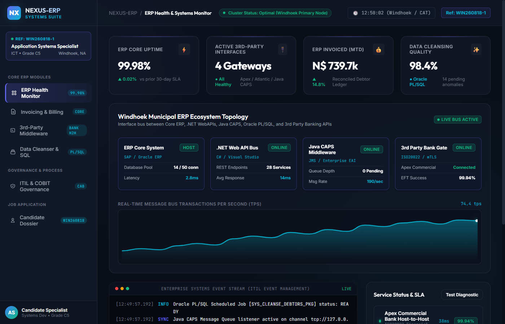

<div align="center">

# NEXUS-ERP: Application Systems Specialist Enterprise Suite

**Official Technical Demonstration Hub & Enterprise ERP Integration Platform**  
*Engineered for Application Systems Specialist (Ref: `WIN260818-1`) — Windhoek, Namibia*

[](LICENSE)
[](https://nodejs.org/)
[](#system-architecture--tech-stack)
[](#core-capabilities)

---


*Fig 1.0 — Real-Time ERP Health Monitor, Windhoek Municipal Topology, Throughput TPS Waveform, and ITIL Event Bus.*

</div>

---

## Table of Contents

- [Executive Overview](#-executive-overview)
- [Core Capabilities](#-core-capabilities)
- [Screenshots](#-screenshots)
- [Quick Start](#-quick-start)
- [System Architecture & Tech Stack](#-system-architecture--tech-stack)
- [Project Structure](#-project-structure)
- [API Endpoints](#-api-endpoints)
- [Job Requirements Alignment (WIN260818-1)](#-job-requirements-alignment-win260818-1)
- [License](#-license)

---

## 🎯 Executive Overview

**NEXUS-ERP** is a full-stack, zero-dependency enterprise application management and ERP integration platform built to demonstrate end-to-end mastery of enterprise systems support, third-party middleware integration, data cleansing, and IT governance.

It combines a modular ES6+ frontend with a lightweight native Node.js REST API (`server.js`)—and can also run standalone directly in any modern browser.

---

## ✨ Core Capabilities

| Module | Highlights |
|---|---|
| **ERP Systems Health & Telemetry** | Live uptime SLA monitoring (`99.98%`), DB connection pooling, CPU telemetry, canvas-based TPS throughput waveforms, interactive diagnostic pings, and live ITIL event logging. |
| **Enterprise Invoicing & Revenue Core** | Full municipal billing lifecycle (`Draft` → `Awaiting Approval` → `Processing` → `Cleared`), automated Namibian VAT (`15%`) calculations, General Ledger (GL) posting (`GL-4100-MUNI-UTIL`, `GL-4200-ICT-CONN`), invoice creation modal, and printable slips with SHA-256 audit hashes. |
| **3rd-Party Systems & Middleware Hub** | Bridges Core ERP with commercial banking and telemetry partners: **Apex Commercial Bank** (ISO20022 `pacs.008`), **Atlantic Corporate Bank** EFT, **Java CAPS** JMS brokers, and AMR SOAP protocols with an interactive XML/JSON payload inspector. |
| **Data Analysis & Cleansing Workbench** | Automated data scrubber that intercepts malformed Namibian VAT registration numbers, trims trailing whitespace, and normalizes unmapped GL records alongside an interactive Oracle SQL & PL/SQL Studio. |
| **ITIL v4 & COBIT 2019 Governance** | Request for Change (RFC) registry, Change Advisory Board (CAB) workflows, COBIT 2019 domain mapping (`BAI06`, `BAI03`, `DSS05`, `MEA02`), and a 5-stage SDLC pipeline. |
| **Candidate Dossier & Pitch Deck** | Qualification verification, CTC & monthly gross remuneration calculator, and an interactive 5-slide executive presentation deck. |

---

## 📸 Screenshots

<div align="center">


*Fig 2.0 — Official Job Requisition `WIN260818-1` Alignment, Remuneration Package Calculator, and KPA Competency Matrix.*

</div>

---

## 🚀 Quick Start

### Option 1: Node.js Server (Recommended)

No external npm packages are required—`server.js` uses only Node.js built-in modules (`http`, `fs`, `path`).

```bash
git clone https://github.com/slyskenk/invoice_management_system.git
cd invoice_management_system
npm start
```

Then open **http://localhost:3000** in your browser.

### Option 2: Standalone Static Launch (Zero-Setup)

Open `public/index.html` directly in Google Chrome, Microsoft Edge, Firefox, or Safari.

---

## 🏛 System Architecture & Tech Stack

- **Frontend UI:** Semantic HTML5 & responsive multi-view layout
- **Styling:** Vanilla CSS3 with custom design tokens (`variables.css`), glassmorphism, dark-mode corporate theme, and Google Fonts (`Outfit`, `Inter`, `JetBrains Mono`)
- **State & Rendering:** Modular Vanilla JavaScript (ES6+), event-driven state engine (`state.js`), and zero-dependency `<canvas>` charts (`charts.js`)
- **Backend API:** Native Node.js HTTP server (`server.js`) serving static assets and RESTful JSON endpoints

---

## 📁 Project Structure

```text
invoice_management_system/
├── public/
│   ├── css/
│   │   ├── variables.css      # Design system tokens & theme variables
│   │   ├── main.css           # Core layout & typography
│   │   ├── components.css     # Modals, badges, tables, cards
│   │   ├── dashboard.css      # Telemetry & chart styles
│   │   └── dossier.css        # Candidate dossier & pitch deck styles
│   ├── js/
│   │   ├── app.js             # Application bootstrap & navigation
│   │   ├── state.js           # Central event-driven state store
│   │   ├── modules/           # Dashboard, Invoices, Integrations, Data Cleanser, ITIL, Dossier
│   │   └── utils/             # Canvas charts & toast notifications
│   └── index.html             # Main SPA entry point
├── server.js                  # Native Node.js HTTP & REST API server
├── package.json               # Project metadata & start scripts
├── screenshot.png             # Dashboard preview
├── screenshot_dossier.png     # Dossier preview
├── LICENSE                    # MIT License
└── README.md
```

---

## 🔌 API Endpoints

| Method | Endpoint | Description |
|---|---|---|
| `GET` | `/api/system/health` | Real-time ERP health, SLA, and telemetry metrics |
| `GET` | `/api/invoices` | List enterprise invoices with VAT & GL metadata |
| `POST` | `/api/invoices` | Create a new invoice and post to GL |
| `GET` | `/api/itil/rfc` | Retrieve ITIL Change Requests & CAB status |
| `GET` | `/api/candidate/profile` | Candidate qualification & remuneration profile |

---

## 📋 Job Requirements Alignment (`WIN260818-1`)

| Requirement | Specification | Implemented Feature |
|---|---|---|
| **Qualification** | 3-Year National Diploma in Business Computing / IS | Profiled in Candidate Dossier & interview pitch deck |
| **Experience** | 3+ Years in Systems Development | Modular architecture, SDLC pipeline & integration engine |
| **Enterprise Support** | ERP improvements, upgrades & module interfaces | Live ERP topology, DB pool diagnostics & `99.98%` SLA tracker |
| **3rd-Party Support** | Interfacing between ERP & 3rd-party systems | Apex Commercial Bank ISO20022, Atlantic Corporate Bank & Java CAPS JMS |
| **Data Cleansing** | Data analysis, integration & data cleansing | Live Data Scrubber + Oracle SQL / PL/SQL studio |
| **Added Advantages** | ITIL, COBIT, Visual Studio, .NET, Java CAPS, SQL/PLSQL | ITIL RFC registry, COBIT 2019 matrix & multi-protocol payloads |

---

## 📄 License

This project is licensed under the **MIT License** — see the [LICENSE](LICENSE) file for details.

---

<div align="center">
  <sub>Engineered with precision for the ICT Recruitment Panel — Windhoek, Namibia.</sub>
</div>
