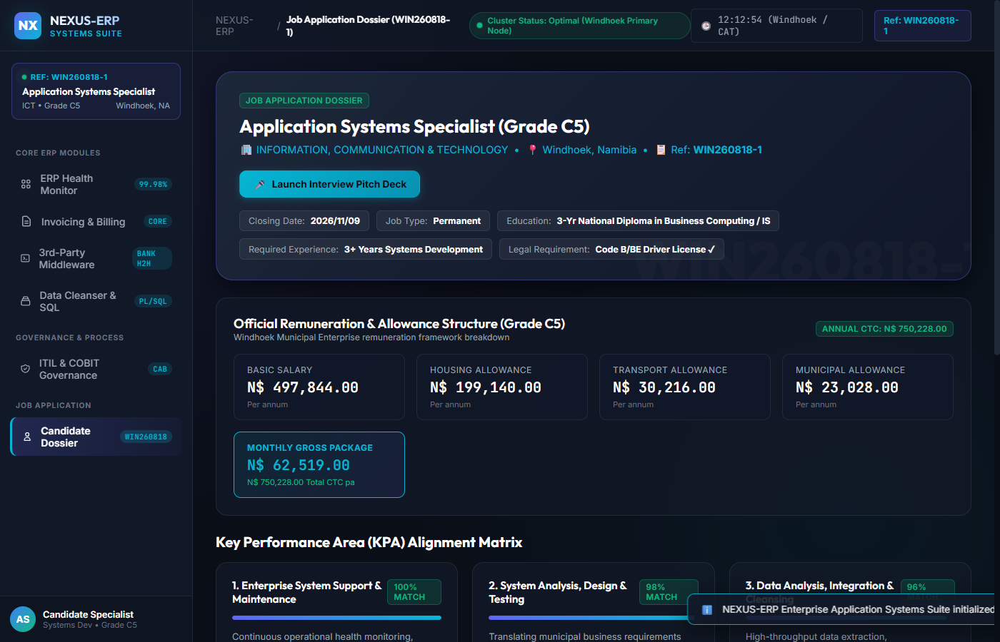

# NEXUS-ERP: Application Systems Specialist Enterprise Suite

[](https://github.com/slyskenk/invoice_management_system/blob/main/LICENSE)
[](https://github.com/slyskenk/invoice_management_system/stargazers)

## 🎯 Executive Overview & Purpose

This repository showcases a **full‑stack enterprise application** built to demonstrate mastery of the **Application Systems Specialist (Ref: WIN260818‑1)** role for the City of Windhoek. It includes:

- Real‑time ERP health monitoring
- End‑to‑end invoicing workflow with VAT calculation
- ITIL v4 change management & COBIT 2019 governance
- Candidate dossier & interview pitch deck
- Extensive documentation and quick‑start guides

---

## 📚 Table of Contents

- [Quick Start Guide](#quick-start-guide)
- [System Architecture & Tech Stack](#system-architecture--tech-stack)
- [Screenshots](#screenshots)
- [Features](#features)
- [Installation & Development](#installation--development)
- [License](#license)

---

## 🚀 Quick Start Guide

### Option 1 – Node.js Server (Recommended)
```bash
npm install            # install dependencies (if any)
npm start              # or: node server.js
```
Open your browser at **http://localhost:3000**.

### Option 2 – Static Browser Launch (Zero‑Setup)
Simply double‑click `public/index.html` or open it via a `file:///` URL.

---

## 🏛 System Architecture & Tech Stack

- **Frontend:** Vanilla HTML5, CSS3 (glassmorphism, dark‑mode theme), JavaScript (ES6+ modules)
- **Backend:** Node.js HTTP server (`server.js`) exposing RESTful endpoints
- **Styling:** Custom design tokens, Google Fonts (Outfit, Inter, JetBrains Mono)
- **Data:** Mock data with VAT calculations, GL posting, and ITIL RFC tracking

---

## 📸 Screenshots


*Real‑time ERP health monitor, topology, throughput waveform, and ITIL event bus.*


*Job requisition alignment, remuneration calculator, and competency matrix.*

---

## ✨ Features

- **ERP Health Dashboard** – Uptime, CPU, DB pool, message bus metrics
- **Invoice Lifecycle** – Draft → Approval → Processing → Cleared with VAT
- **3rd‑Party Integration Hub** – ISO20022, EFT, JMS, SOAP adapters
- **Data Cleansing Workbench** – Automated VAT number validation & GL normalisation
- **ITIL & COBIT Governance** – RFC tracking, CAB workflow, COBIT domain mapping
- **Candidate Dossier** – Full qualification verification & pitch deck

---

## 🛠 Installation & Development

1. Clone the repository:
```bash
git clone https://github.com/slyskenk/invoice_management_system.git
cd invoice_management_system
```
2. (Optional) Install Node.js dependencies:
```bash
npm install
```
3. Run the server as described in the Quick Start Guide.

---

## 📄 License

This project is licensed under the **MIT License** – see the [LICENSE](LICENSE) file for details.

---

*Engineered with precision for the ICT Recruitment Panel, Windhoek, Namibia.*
